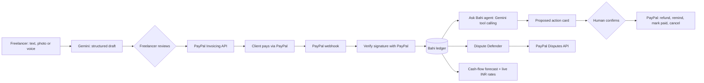

# Bahi: an AI back office for freelancers paid through PayPal

**Live demo:** https://bahi-qel1.onrender.com (PayPal sandbox, no real money moves; the free server may take about 50 seconds to wake up)

*Bahi-khata* is the red cloth ledger Indian traders have kept for generations. Bahi is that ledger, rebuilt as an AI agent on top of PayPal.

## The problem

Millions of Indian freelancers, designers and small exporters get paid by overseas clients through PayPal. Most of them do the back office by hand, in English, which is often their second language: writing invoices, chasing late payers, issuing refunds, and answering disputes under deadline. A single lost dispute can wipe out a month of income.

## What Bahi does

| Feature | What happens |
|---|---|
| **Say it, snap it or type it** | Write *"Sarah ko 3 logo designs ka total $450 bhejo, sarah@acme.com, 2 hafte me"*, record a voice note, or photograph a handwritten bill. Gemini turns it into a structured invoice draft (it even ignores crossed-out prices). Bahi never invents an email; it asks. |
| **Real PayPal invoices** | After you review the draft, Bahi creates and sends a real PayPal invoice (sandbox) under your business name. |
| **Live payment loop** | When the client pays, PayPal sends a webhook. Bahi verifies the signature with PayPal, fetches the invoice and marks it PAID in the ledger within seconds. |
| **Ask Bahi (agent)** | Chat in Hinglish, Hindi or English: *"Kaun kaun late hai? Sabko reminder bhejo"*. A Gemini tool-calling agent looks up invoices in PayPal and **proposes** reminders, refunds, mark-as-paid or cancellations. Nothing happens until you tap **Confirm**; refunds above a safety limit are flagged. |
| **Dispute Defender** | Gathers the evidence (invoice, payments, refunds, full activity timeline), gives an honest assessment (strength, win chance, what helps, what hurts, what proof to attach) and drafts the PayPal response and a message to the buyer. It never claims an attachment exists. You decide: respond, offer a partial refund, or accept. |
| **Cash-flow forecast** | Predicts when each unpaid invoice will likely be paid, from the client's real payment history and how overdue it is, converts to INR at live reference rates, and charts the next 30 days with an AI insight on the biggest risk. |

## How PayPal is used

All calls go to the **PayPal REST APIs (sandbox)** from `paypal_client.py`, `agent.py` and `disputes.py`:

- **OAuth 2.0** client-credentials token, cached until expiry
- **Invoicing v2**: generate next number, create, send, get, list, **remind**, **cancel**, **record payment** (paid outside PayPal), **record refund**
- **Payments v2**: refund a **capture** for invoices paid through PayPal checkout (money returns to the buyer)
- **Webhooks**: register (`/v1/notifications/webhooks`) and **verify every event** (`/v1/notifications/verify-webhook-signature`) for `INVOICING.INVOICE.*`, `PAYMENT.CAPTURE.*` and `CUSTOMER.DISPUTE.*`
- **Disputes v1**: list, get, **provide-evidence**, **make-offer**, **accept-claim**
- **PayPal checkout** is what the client uses to pay each invoice

## How AI is used

**Google Gemini** (`gemini-flash-latest`, via the `google-genai` SDK):

- **Multimodal structured extraction** (`ai.py`): text, images and audio in; a strict Pydantic schema out (client, email, currency, items, due date, missing fields, confidence).
- **Tool-calling agent** (`agent.py`): read-only tools run immediately; every action tool only creates a proposal that a human must confirm. Duplicate proposals are merged.
- **Dispute assessment** (`disputes.py`): structured, deliberately honest output at low temperature; rules forbid invented evidence.
- **Forecast insight** (`forecast.py`): a short explanation grounded only in the computed forecast.

Reliability: 20-second timeouts, retries on overload, and automatic fallback to backup Gemini models, so a busy model never freezes the app.

## Architecture



**Stack:** Python 3.12, FastAPI, SQLite, vanilla HTML/CSS/JS, Google Gemini, PayPal REST APIs, deployed on **Render**.

## Deployed on Render

`render.yaml` is a Render Blueprint: one click creates the web service, build command, health check and environment variables. Because free instances start with an empty disk, Bahi **rebuilds its ledger from PayPal on startup**, so PayPal stays the source of truth.

## Run it yourself

1. Create a **PayPal sandbox app** at developer.paypal.com (Apps & Credentials > Sandbox). Use a **US** sandbox business account, with **Invoicing** and **Customer disputes** enabled.
2. Get a **Gemini API key** at aistudio.google.com.
3. Install:

```bash
git clone https://github.com/pandeylakshya207-max/bahi.git
cd bahi
python -m venv .venv
# Windows: .venv\Scripts\activate    macOS/Linux: source .venv/bin/activate
pip install -r requirements.txt
```

4. Create a `.env` file:

```
PAYPAL_CLIENT_ID=your-sandbox-client-id
PAYPAL_CLIENT_SECRET=your-sandbox-secret
PAYPAL_BASE=https://api-m.sandbox.paypal.com
GEMINI_API_KEY=your-gemini-key
GEMINI_MODEL=gemini-flash-latest
BAHI_BUSINESS_NAME=Aarav Designs
```

5. Optional demo data: `python seed_demo.py` (overdue clients in USD, EUR and GBP) and `python seed_dispute.py` (a clearly labelled demo dispute).
6. Run `uvicorn main:app --reload`, then open http://127.0.0.1:8000
7. For live payment updates, expose the app (for example `cloudflared tunnel --url http://localhost:8000`) and run `python register_webhook.py https://your-public-url`.

## Honest notes

- Everything runs in the **PayPal sandbox**; no real money moves.
- The sandbox did not let us open a real buyer dispute on our test payment, so the Dispute Defender demo uses a **clearly labelled demo dispute** with the same shape as PayPal's dispute object. The real Disputes API path (list, get, provide-evidence, make-offer, accept-claim) is implemented and used automatically when real disputes exist.
- Exchange rates are reference rates; what a freelancer receives depends on PayPal's conversion and fees.

## License

MIT, see [LICENSE](LICENSE).
